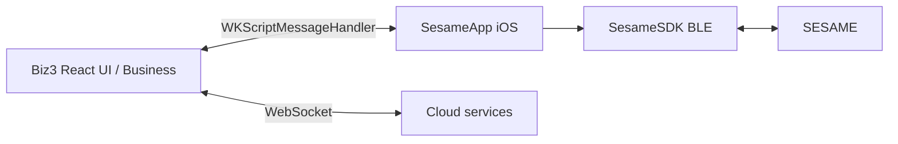
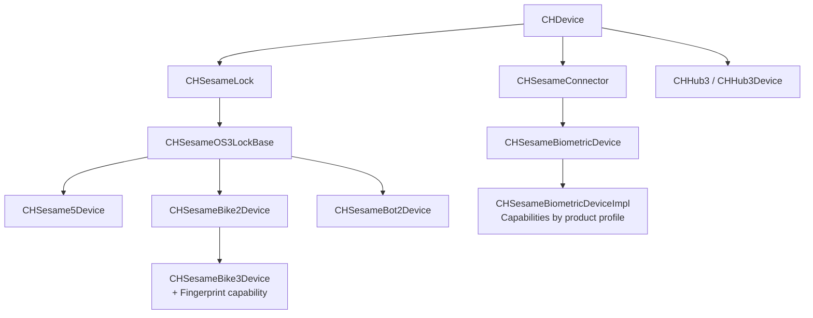
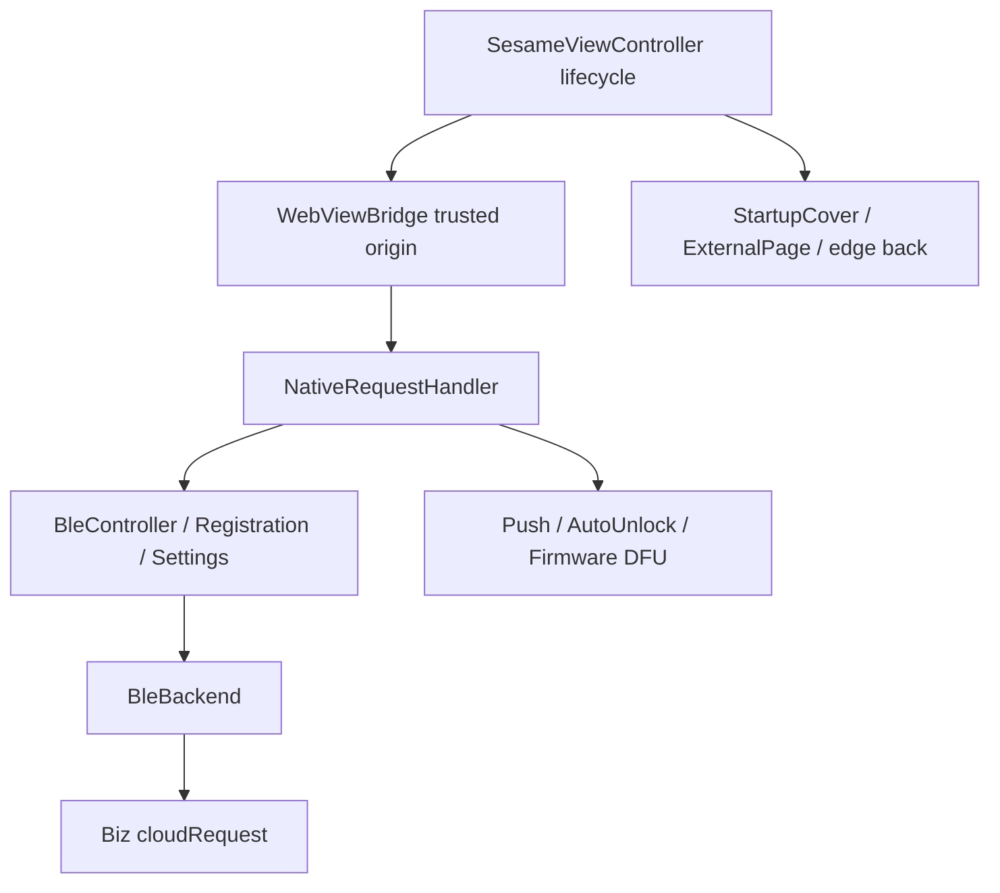

# SesameOS3 iOS

日本語 | [简体中文](README_zh-CN.md) | [English](README_en.md)

iOS Web App のホストと Swift 製 Sesame SDK を収録したオープンソースプロジェクトです。画面・アカウント・クラウド業務は Biz3、WebView・Bluetooth・OS 機能は iOS が担当します（Android Web App と同じ構成）。

**Biz は業務ロジック、iOS はネイティブ機能、Bridge は通信を担当します。**



> 移行状況：Android Web App と同じ機能（BLE 一覧・登録・開閉、各機種の設定・認証情報・ファームウェア更新、プッシュ、自動解錠、内部テスト）を実装済みです。SDK は BLE のみとなり、クラウド処理は `CHBleHost` 経由で Biz に委ねます。Siri／ショートカットはメイン App 内の App Intents に移行済み（旧フレーズ互換）で、Bluetooth が使えない場合は `SesameGateway`（`SesameApp/SesameGateway`）経由でゲートウェイから操作します。

- [CANDY HOUSE 公式サイト](https://jp.candyhouse.co/)
- [App Store](https://apps.apple.com/app/id1532692301/)
- [TestFlight](https://testflight.apple.com/join/Rok4GOFD/)

## SDK の導入

### 動作環境

- Xcode 15 以降
- Swift 5.9 以降
- iOS 16 以降 / watchOS 9 以降

### 1. Swift Package Manager で追加する

Xcode の **File > Add Package Dependencies...** から、次の URL を追加します。

```text
https://github.com/CANDY-HOUSE/SesameSDK_iOS_with_DemoApp.git
```

`Package.swift` から追加する場合は、`<version>` を [Tags](https://github.com/CANDY-HOUSE/SesameSDK_iOS_with_DemoApp/tags) にある利用したいバージョンタグへ置き換えてください。

```swift
dependencies: [
    .package(
        url: "https://github.com/CANDY-HOUSE/SesameSDK_iOS_with_DemoApp.git",
        from: "<version>"
    )
]
```

利用するターゲットに `SesameSDK` を追加し、Swift ファイルで読み込みます。

```swift
import SesameSDK
```

### 2. Bluetooth 権限を設定する

アプリの `Info.plist` に Bluetooth の利用目的を追加してください。バックグラウンドで BLE 接続を継続する場合は、Background Modes の `bluetooth-central` も有効にします。

```xml
<key>NSBluetoothAlwaysUsageDescription</key>
<string>Sesame デバイスへの接続に Bluetooth を使用します。</string>
<key>NSBluetoothPeripheralUsageDescription</key>
<string>Sesame デバイスとの Bluetooth 通信に使用します。</string>
```

### 3. 初期化

起動時に `CHBleSupport` を初期化します。`host` は登録・制限付き鍵の署名・履歴や電池のアップロードを提供する `CHBleHost`、`keys` は鍵の保存と削除を担当する `CHKeyPersistence` の実装です。`gatewayTenantId` は WM2 の Wi-Fi 接続で使う ID プール ID です。SDK は通信方式や保存先を指定しません。インターフェースは [CHBleSupport.swift](Sources/SesameSDK/Ble/CHBleSupport.swift) を参照してください。

```swift
CHBleSupport.initialize(host: backend, keys: keyStore, gatewayTenantId: identityPoolId)
```

### 4. デバイスを検出・登録する

```swift
final class DeviceScanner: CHBleManagerDelegate, CHDeviceStatusDelegate {
    private var target: CHDevice?

    func start() {
        CHBluetoothCenter.shared.delegate = self
        CHBluetoothCenter.shared.enableScan { _ in }
    }

    func didDiscoverUnRegisteredCHDevices(_ devices: [CHDevice]) {
        guard let device = devices.first else { return }
        target = device
        device.delegate = self
        if device.deviceStatus == .receivedBle() {
            device.connect { _ in }
        }
    }

    func onBleDeviceStatusChanged(
        device: CHDevice,
        status: CHDeviceStatus,
        shadowStatus: CHDeviceStatus?
    ) {
        guard status == .readyToRegister(), device.deviceId == target?.deviceId else { return }
        device.register { result in
            if case .failure(let error) = result {
                print(error.localizedDescription)
            }
        }
    }
}
```

登録後に生成された鍵は `CHKeyPersistence.save` に渡されます。保存済みの鍵（下記の `savedKey`）は `restoreDevice` で復元し、BLE ログイン後に操作します。

```swift
if let device = CHBluetoothCenter.shared.restoreDevice(savedKey) {
    device.delegate = statusDelegate
    device.connect { _ in }
    // After BLE login, for a CHSesame5-compatible device:
    (device as? CHSesame5)?.toggle(historytag: historyTag) { _ in }
}
```

## プロジェクト構成

| パス | 説明 |
| --- | --- |
| `Package.swift` | `SesameSDK` と `AESc` を公開する Swift Package 定義 |
| `Sources/SesameSDK` | BLE、OS2/OS3 デバイス、ホスト契約（`CHBleSupport`） |
| `Sources/SesameSDK/Ble/SesameOS3` | 現在メンテナンスしている OS3 実装 |
| `SesameApp/SesameApp` | iOS アプリ：WKWebView ホスト（`App`）、Bridge（`Bridge`）、BLE と設定（`Ble`）、鍵と旧データ（`Data`）、プッシュ（`Push`）、自動解錠（`AutoUnlock`）、外部ページ・起動カバー（`UI`） |
| `SesameApp/NotificationService` | プッシュ画像添付の Notification Service Extension |
| `SesameApp/Config` | Biz ページのドメイン（xcconfig） |

## OS3 デバイス構成



### メンテナンス対象製品

製品範囲は `CHProductModel` を基準とし、実際の Device 実装ごとに分類しています。

| Device 実装 | 製品 |
| --- | --- |
| `CHSesame5Device` | Sesame 5、Sesame 5 Pro、Sesame 5 US、Sesame 6、Sesame 6 Pro、Sesame 6 Pro SlidingDoor、Sesame miwa、BLE Connector 1 |
| `CHSesameBike2Device` | Sesame Bike 2 |
| `CHSesameBike3Device` | Sesame Bike 3（指紋機能） |
| `CHSesameBot2Device` | Sesame Bot 2、Sesame Bot 3 |
| `CHSesameBiometricDeviceImpl` | Open Sensor 1/2、Remote、Remote Nano、Sesame Touch 1/1 Pro/2/2 Pro、Sesame Face 1/1 Pro/1 AI/1 Pro AI/2/2 Pro/2 AI/2 Pro AI |
| `CHHub3Device` | Hub 3、Hub 3 LTE |

> メンテナンス終了：Sesame 3（`sesame2`）、WiFi Module 2（`wifiModule2`）、Sesame Bot 1（`sesameBot`）、Sesame Bike 1（`bikeLock`）、Sesame 4（`sesame4`）。SesameOS2 実装もメンテナンス対象外です。

### 生体認証 Capability

`CHSesameBiometricDeviceImpl` は製品 Profile に応じて Capability を組み合わせます。

| 製品シリーズ | Capability |
| --- | --- |
| Touch | Card、Fingerprint |
| Touch Pro | Card、Fingerprint、Passcode |
| Face | Card、Fingerprint、Palm、Face |
| Face Pro | Card、Fingerprint、Passcode、Palm、Face |
| Face AI | Palm、Face |
| Face Pro AI | Passcode、Palm、Face |

関連 API：`CHCardCapable`、`CHFingerPrintCapable`、`CHPassCodeCapable`、`CHPalmCapable`、`CHFaceCapable`、`CHRemoteNanoCapable`。

## メンテナンス方針

- 新製品は `CHProductModel` に追加し、対応する OS3 Device 実装へマッピングします。
- 共通処理は基底クラスへ集約し、製品差分は専用実装または Capability の組み合わせで表現します。
- `Sources/SesameSDK/Ble/SesameOS2` は互換性維持のための旧実装であり、現在のメンテナンス対象外です。

## 内部開発

Biz ページのドメインは `SesameApp/Config/App.xcconfig` の `SESAME_WEB_HOST` で指定し、Info.plist の `SesameWebHost` と `WKAppBoundDomains` に反映されます。Release は `biz.candyhouse.co`（HTTPS）です。Debug は `localhost`（Biz 開発サーバー `http://localhost:3000`）または検証環境のドメイン（HTTPS）を各自で設定します。実機の `localhost` は端末自身です。実機からローカルに接続する場合は `SESAME_DEV_MAC_IP` に Mac の LAN IP を設定します。App（Debug のみ）が端末の `localhost:3000` で待ち受け、Mac の `IP:3000` へ転送するため（`adb reverse` と同様）、ページのアドレスは `http://localhost:3000` のままです。初回は「ローカルネットワーク」の許可が必要で、端末と Mac は同じ LAN に接続します。シミュレーターと検証環境では `SESAME_DEV_MAC_IP` を空のままにします。変更はコミットしません。

Web APP ルートから、それぞれ別のターミナルで実行します。Biz の開発サーバーは起動したままにします。

```bash
# Terminal 1: Biz3
cd Biz3
nvm use
yarn install --frozen-lockfile
yarn dev
```

```bash
# Terminal 2: iOS（Xcode で SesameApp.xcodeproj を開いて実行しても同じ）
cd SesameOS3_iOS/SesameApp
xcodebuild -project SesameApp.xcodeproj -scheme SesameApp -destination 'platform=iOS Simulator,name=iPhone 18 Pro' build
```

Bundle ID `co.candyhouse.sesame2`、App Group `group.candyhouse.widget`、Keychain 共有グループは旧ネイティブ版と同じで、上書きインストールで旧データを引き継ぎます。

## 役割分担

Biz は業務ルール・状態管理・画面操作・クラウド要求を実装します。iOS は WKWebView・BLE・権限・永続化・OS 機能を提供します。Bridge は信頼元の検証と要求・応答・イベントの通信を担当し、業務ロジックを持ちません。



- ページ → ネイティブ：`webkit.messageHandlers.sesameNative`。メインフレームかつ `SesameWebOrigin` と同じ scheme・host・port の場合のみ受け付けます。
- ネイティブ → ページ：`__sesameNativeReceive`。メッセージ形式（`{action, requestId, ...}`、`{type, data}`）とアクション名は Android と同じです。
- ドキュメントが切り替わると Bridge の世代を進め、未完了の要求と遅れた応答を破棄します。
- 外部ページは Bridge を持たない別の WKWebView で開き、http・mailto・tel はシステムに渡します。カメラ・マイクは信頼元にのみ許可します。
- iOS には戻るキーがないため、左端からのスワイプで Biz に `back` を送ります（タブのルート画面では何もしません）。

鍵は Keychain（`AfterFirstUnlockThisDeviceOnly`、共有グループ）に保存し、WebView ストレージには置きません。旧ネイティブ版の `CHDeviceModel.sqlite` の鍵は初回起動時に Keychain へ移し、読み戻し確認後に旧ファイルを削除します。`home.deviceKey` は表示中または未アップロードの鍵だけを返します。

Amplify は旧ログインの引き継ぎ用の Auth（Cognito）プラグインのみを使用します。
