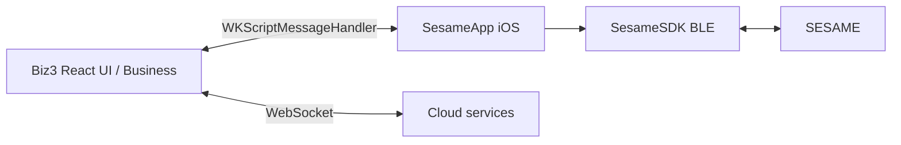
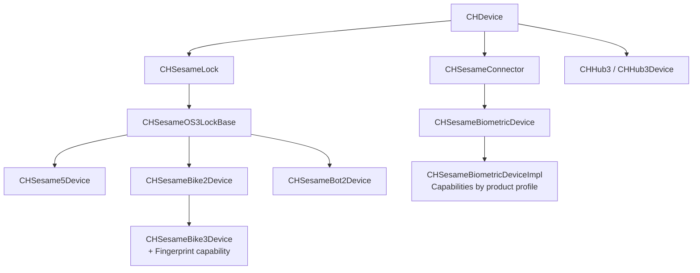
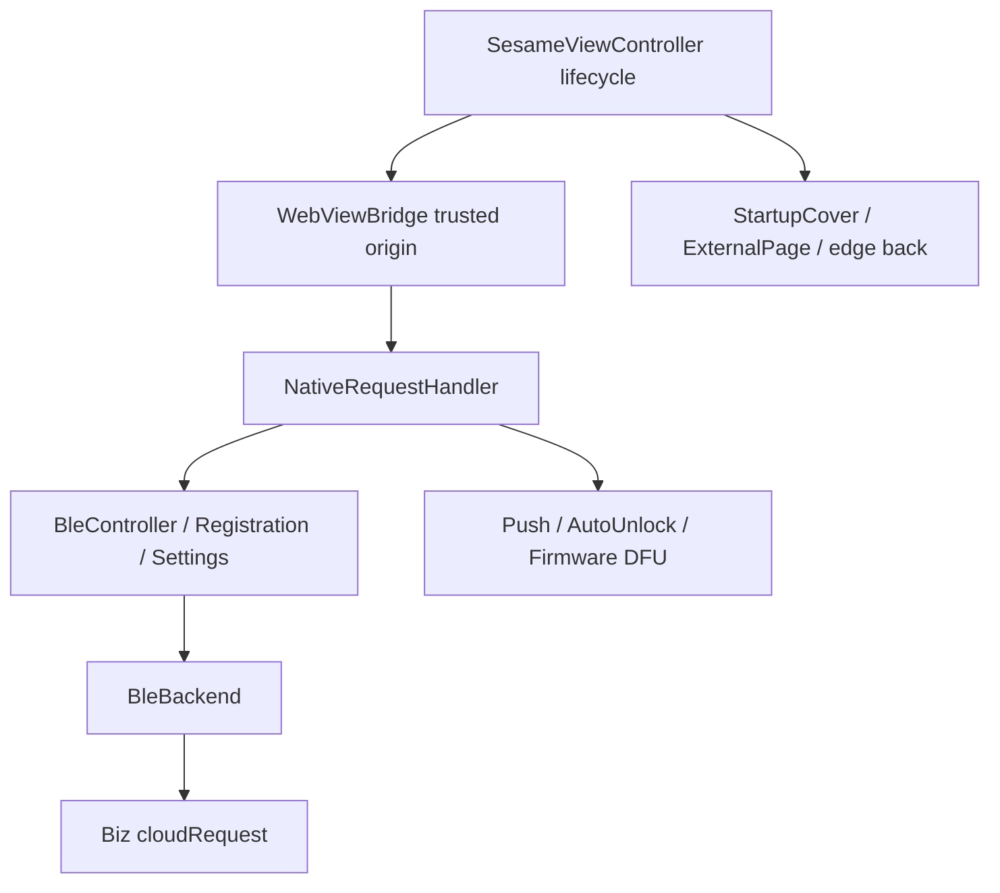

# SesameOS3 iOS

[日本語](README.md) | [简体中文](README_zh-CN.md) | English

The iOS Web App host and the Swift-based Sesame SDK. Pages, accounts and cloud business logic live in Biz3; the WebView, Bluetooth and OS features live in iOS (the same architecture as the Android Web App).

**Biz owns business logic, iOS owns native capabilities, and the Bridge owns communication.**



> iOS-only features: Siri and Shortcuts (App Intents, legacy phrases still work) and Apple Watch (`SesameWatch`). Both run without the WebView and fall back to the gateway through `SesameGateway` when Bluetooth is unavailable.

- [CANDY HOUSE official website](https://jp.candyhouse.co/)
- [App Store](https://apps.apple.com/app/id1532692301/)
- [TestFlight](https://testflight.apple.com/join/Rok4GOFD/)

## Integrating the SDK

### Requirements

- Xcode 15 or later
- Swift 5.9 or later
- iOS 16 or later / watchOS 9 or later

### 1. Add the Swift package

In Xcode, select **File > Add Package Dependencies...** and enter:

```text
https://github.com/CANDY-HOUSE/SesameSDK_iOS_with_DemoApp.git
```

When using `Package.swift`, replace `<version>` with the desired version tag from [Tags](https://github.com/CANDY-HOUSE/SesameSDK_iOS_with_DemoApp/tags):

```swift
dependencies: [
    .package(
        url: "https://github.com/CANDY-HOUSE/SesameSDK_iOS_with_DemoApp.git",
        from: "<version>"
    )
]
```

Add `SesameSDK` to the required target, then import it in Swift:

```swift
import SesameSDK
```

### 2. Configure Bluetooth access

Add a Bluetooth usage description to the app's `Info.plist`. To maintain BLE connections in the background, also enable `bluetooth-central` under Background Modes.

```xml
<key>NSBluetoothAlwaysUsageDescription</key>
<string>Bluetooth is used to connect to Sesame devices.</string>
<key>NSBluetoothPeripheralUsageDescription</key>
<string>Bluetooth is used to communicate with Sesame devices.</string>
```

### 3. Initialize

Initialize `CHBleSupport` at launch. `host` is your `CHBleHost`, which provides registration, restricted-key signing and history/battery upload; `keys` is your `CHKeyPersistence`, which saves and deletes keys. `gatewayTenantId` is the identity pool ID WM2 uses when joining Wi-Fi. The SDK does not prescribe a backend or storage. See [CHBleSupport.swift](Sources/SesameSDK/Ble/CHBleSupport.swift).

```swift
CHBleSupport.initialize(host: backend, keys: keyStore, gatewayTenantId: identityPoolId)
```

### 4. Discover and register a device

```swift
final class DeviceScanner: CHBleManagerDelegate, CHDeviceStatusDelegate {
    private var target: CHDevice?

    func start() {
        CHBluetoothCenter.shared.delegate = self
        CHBluetoothCenter.shared.enableScan { _ in }
    }

    func didDiscoverUnRegisteredCHDevices(_ devices: [CHDevice]) {
        guard let device = devices.first else { return }
        target = device
        device.delegate = self
        if device.deviceStatus == .receivedBle() {
            device.connect { _ in }
        }
    }

    func onBleDeviceStatusChanged(
        device: CHDevice,
        status: CHDeviceStatus,
        shadowStatus: CHDeviceStatus?
    ) {
        guard status == .readyToRegister(), device.deviceId == target?.deviceId else { return }
        device.register { result in
            if case .failure(let error) = result {
                print(error.localizedDescription)
            }
        }
    }
}
```

After registration the generated key is passed to `CHKeyPersistence.save`. Restore a saved key (`savedKey` below) with `restoreDevice` and operate the device after BLE login:

```swift
if let device = CHBluetoothCenter.shared.restoreDevice(savedKey) {
    device.delegate = statusDelegate
    device.connect { _ in }
    // After BLE login, for a CHSesame5-compatible device:
    (device as? CHSesame5)?.toggle(historytag: historyTag) { _ in }
}
```

## Project structure

| Path | Description |
| --- | --- |
| `Package.swift` | Swift Package definition exposing `SesameSDK` and `AESc` |
| `Sources/SesameSDK` | BLE, OS2/OS3 devices, host contract (`CHBleSupport`) |
| `Sources/SesameSDK/Ble/SesameOS3` | Currently maintained OS3 implementations |
| `SesameApp/SesameApp` | iOS app: WKWebView host (`App`), Bridge (`Bridge`), BLE and settings (`Ble`), keys and legacy data (`Data`), push (`Push`), auto unlock (`AutoUnlock`), external page and startup cover (`UI`) |
| `SesameApp/NotificationService` | Notification Service Extension for push image attachments |
| `SesameApp/SesameWatch` | Apple Watch app |
| `SesameApp/SesameGateway` | Gateway REST client for Siri and Watch (Swift Package) |
| `SesameApp/Config` | Biz page domain (xcconfig) |

## OS3 device architecture



### Maintained products

The product range is defined by `CHProductModel` and grouped by the actual Device implementation.

| Device implementation | Products |
| --- | --- |
| `CHSesame5Device` | Sesame 5, Sesame 5 Pro, Sesame 5 US, Sesame 6, Sesame 6 Pro, Sesame 6 Pro SlidingDoor, Sesame miwa, BLE Connector 1 |
| `CHSesameBike2Device` | Sesame Bike 2 |
| `CHSesameBike3Device` | Sesame Bike 3 (with fingerprint capability) |
| `CHSesameBot2Device` | Sesame Bot 2, Sesame Bot 3 |
| `CHSesameBiometricDeviceImpl` | Open Sensor 1/2, Remote, Remote Nano, Sesame Touch 1/1 Pro/2/2 Pro, Sesame Face 1/1 Pro/1 AI/1 Pro AI/2/2 Pro/2 AI/2 Pro AI/3 |
| `CHHub3Device` | Hub 3, Hub 3 Pro |

> No longer maintained: Sesame 3 (`sesame2`), WiFi Module 2 (`wifiModule2`), Sesame Bot 1 (`sesameBot`), Sesame Bike 1 (`bikeLock`), and Sesame 4 (`sesame4`). SesameOS2 implementations are also outside the current maintenance scope.

### Biometric capabilities

`CHSesameBiometricDeviceImpl` assembles capabilities based on each product profile.

| Product family | Capabilities |
| --- | --- |
| Touch | Card, fingerprint |
| Touch Pro | Card, fingerprint, passcode |
| Face | Card, fingerprint, palm, face |
| Face Pro | Card, fingerprint, passcode, palm, face |
| Face AI | Palm, face |
| Face Pro AI | Passcode, palm, face |

Related APIs: `CHCardCapable`, `CHFingerPrintCapable`, `CHPassCodeCapable`, `CHPalmCapable`, `CHFaceCapable`, and `CHRemoteNanoCapable`.

## Maintenance policy

- Add new products to `CHProductModel` and map them to the corresponding OS3 Device implementation.
- Keep shared behavior in base classes; implement product differences through dedicated implementations or Capability composition.
- `Sources/SesameSDK/Ble/SesameOS2` contains legacy compatibility code and is outside the current maintenance scope.

## Internal development

The Biz page domain is `SESAME_WEB_HOST` in `SesameApp/Config/App.xcconfig`, written to `SesameWebHost` and `WKAppBoundDomains` in Info.plist. Release uses `biz.candyhouse.co` (HTTPS). For Debug, set either `localhost` (the Biz dev server at `http://localhost:3000`) or a staging domain (HTTPS) yourself. On a device, `localhost` is the phone itself: to reach the local server, set `SESAME_DEV_MAC_IP` to the Mac's LAN IP. The app (Debug only) then listens on the phone's `localhost:3000` and forwards to the Mac's `IP:3000` (like `adb reverse`), so the page stays at `http://localhost:3000`. Allow the Local Network permission on first run; the phone and the Mac must be on the same LAN. Leave `SESAME_DEV_MAC_IP` empty for the simulator and staging domains. Do not commit these edits.

From the Web APP root, run each in its own terminal. Keep the Biz dev server running.

```bash
# Terminal 1: Biz3
cd Biz3
nvm use
yarn install --frozen-lockfile
yarn dev
```

```bash
# Terminal 2: iOS (or open SesameApp.xcodeproj in Xcode and run)
cd SesameOS3_iOS/SesameApp
xcodebuild -project SesameApp.xcodeproj -scheme SesameApp -destination 'platform=iOS Simulator,name=iPhone 18 Pro' build
```

The bundle ID `co.candyhouse.sesame2`, App Group `group.candyhouse.widget` and Keychain access group are unchanged from the previous native app, so an over-the-top install keeps existing data.

## Responsibilities

Biz implements business rules, state, page interaction and cloud requests. iOS provides the WKWebView, BLE, permissions, persistence and OS features. The Bridge verifies the trusted origin and carries requests, responses and events; it holds no business logic.



- Page → native: `webkit.messageHandlers.sesameNative`, accepted only from the main frame whose scheme, host and port match `SesameWebOrigin`.
- Native → page: `__sesameNativeReceive`. The message formats (`{action, requestId, ...}`, `{type, data}`) and action names match Android.
- When the main document changes, the Bridge advances its generation and drops unfinished requests and late replies.
- External pages open in a separate WKWebView without the Bridge; http, mailto and tel go to the system. Camera and microphone are granted only to the trusted origin.
- iOS has no back key: a swipe from the left edge sends `back` to Biz (nothing happens on a root tab).

Keys are stored in the Keychain (`AfterFirstUnlockThisDeviceOnly`, shared access group), never in WebView storage. Keys in the previous app's `CHDeviceModel.sqlite` move to the Keychain on first launch, and the old file is deleted only after every key reads back. `home.deviceKey` returns only visible or not-yet-uploaded keys.

Amplify is used only for its Auth (Cognito) plugin, to hand over the legacy sign-in.
