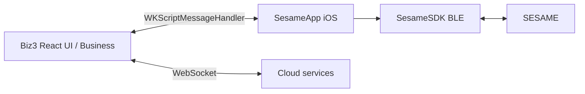
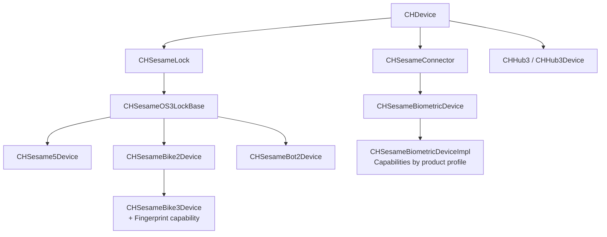
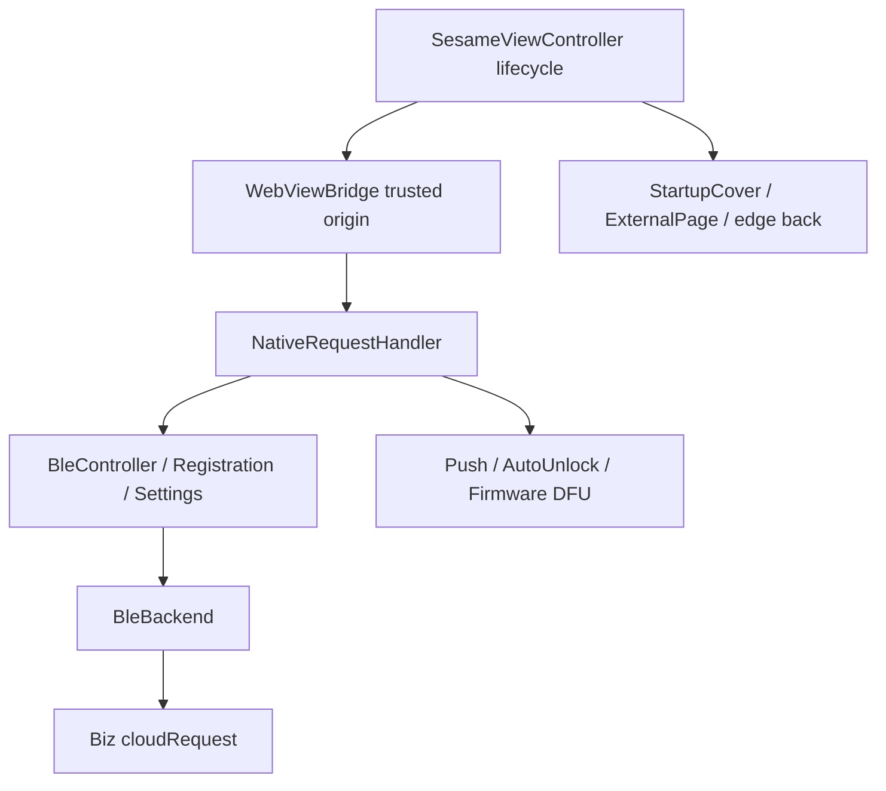

# SesameOS3 iOS

[日本語](README.md) | 简体中文 | [English](README_en.md)

iOS Web App 宿主与 Swift Sesame SDK 开源项目。页面、账号与云端业务由 Biz3 负责，WebView、蓝牙与系统能力由 iOS 负责（与 Android Web App 架构相同）。

**Biz 负责业务逻辑，iOS 负责原生能力，Bridge 负责通信。**



> 迁移状态：已实现与 Android Web App 相同的功能（BLE 列表、注册、开关锁，各机型设置、凭证、固件升级，推送、自动解锁、内测页）。SDK 只保留 BLE，云端步骤经 `CHBleHost` 交给 Biz。Siri／快捷指令已改为主 App 内的 App Intents（旧短语兼容），蓝牙不可用时经 `SesameGateway`（`SesameApp/SesameGateway`）走网关。

- [CANDY HOUSE 官网](https://jp.candyhouse.co/)
- [App Store](https://apps.apple.com/app/id1532692301/)
- [TestFlight](https://testflight.apple.com/join/Rok4GOFD/)

## 接入 SDK

### 开发环境

- Xcode 15 或更高版本
- Swift 5.9 或更高版本
- iOS 16 或更高版本 / watchOS 9 或更高版本

### 1. 通过 Swift Package Manager 添加依赖

在 Xcode 中选择 **File > Add Package Dependencies...**，添加以下地址：

```text
https://github.com/CANDY-HOUSE/SesameSDK_iOS_with_DemoApp.git
```

通过 `Package.swift` 添加时，请将 `<version>` 替换为 [Tags](https://github.com/CANDY-HOUSE/SesameSDK_iOS_with_DemoApp/tags) 中需要使用的版本标签：

```swift
dependencies: [
    .package(
        url: "https://github.com/CANDY-HOUSE/SesameSDK_iOS_with_DemoApp.git",
        from: "<version>"
    )
]
```

为需要使用 SDK 的 Target 添加 `SesameSDK`，然后在 Swift 文件中导入：

```swift
import SesameSDK
```

### 2. 配置蓝牙权限

在应用的 `Info.plist` 中添加蓝牙用途说明。如需在后台保持 BLE 连接，还应在 Background Modes 中启用 `bluetooth-central`。

```xml
<key>NSBluetoothAlwaysUsageDescription</key>
<string>使用蓝牙连接 Sesame 设备。</string>
<key>NSBluetoothPeripheralUsageDescription</key>
<string>使用蓝牙与 Sesame 设备通信。</string>
```

### 3. 初始化

启动时初始化 `CHBleSupport`。`host` 是提供注册、受限钥匙签名、历史与电量上传的 `CHBleHost`，`keys` 是负责保存和删除钥匙的 `CHKeyPersistence` 实现。`gatewayTenantId` 是 WM2 连接 Wi-Fi 时使用的身份池 ID。SDK 不指定后端通信方式和存储方式，接口见 [CHBleSupport.swift](Sources/SesameSDK/Ble/CHBleSupport.swift)。

```swift
CHBleSupport.initialize(host: backend, keys: keyStore, gatewayTenantId: identityPoolId)
```

### 4. 发现并注册设备

```swift
final class DeviceScanner: CHBleManagerDelegate, CHDeviceStatusDelegate {
    private var target: CHDevice?

    func start() {
        CHBluetoothCenter.shared.delegate = self
        CHBluetoothCenter.shared.enableScan { _ in }
    }

    func didDiscoverUnRegisteredCHDevices(_ devices: [CHDevice]) {
        guard let device = devices.first else { return }
        target = device
        device.delegate = self
        if device.deviceStatus == .receivedBle() {
            device.connect { _ in }
        }
    }

    func onBleDeviceStatusChanged(
        device: CHDevice,
        status: CHDeviceStatus,
        shadowStatus: CHDeviceStatus?
    ) {
        guard status == .readyToRegister(), device.deviceId == target?.deviceId else { return }
        device.register { result in
            if case .failure(let error) = result {
                print(error.localizedDescription)
            }
        }
    }
}
```

注册完成后，生成的钥匙交给 `CHKeyPersistence.save`。已保存的钥匙（下例中的 `savedKey`）用 `restoreDevice` 恢复，BLE 登录后即可操作：

```swift
if let device = CHBluetoothCenter.shared.restoreDevice(savedKey) {
    device.delegate = statusDelegate
    device.connect { _ in }
    // After BLE login, for a CHSesame5-compatible device:
    (device as? CHSesame5)?.toggle(historytag: historyTag) { _ in }
}
```

## 项目结构

| 路径 | 说明 |
| --- | --- |
| `Package.swift` | 定义 `SesameSDK` 与 `AESc` 的 Swift Package |
| `Sources/SesameSDK` | BLE、OS2/OS3 设备实现、宿主契约（`CHBleSupport`） |
| `Sources/SesameSDK/Ble/SesameOS3` | 当前维护的 OS3 实现 |
| `SesameApp/SesameApp` | iOS App：WKWebView 宿主（`App`）、Bridge（`Bridge`）、BLE 与设置（`Ble`）、钥匙与旧数据（`Data`）、推送（`Push`）、自动解锁（`AutoUnlock`）、外部网页与启动遮罩（`UI`） |
| `SesameApp/NotificationService` | 推送图片附件的 Notification Service 扩展 |
| `SesameApp/Config` | Biz 页面域名（xcconfig） |

## OS3 设备架构



### 当前维护产品

产品范围以 `CHProductModel` 为准，并按实际 Device 实现分组：

| Device 实现 | 产品 |
| --- | --- |
| `CHSesame5Device` | Sesame 5、Sesame 5 Pro、Sesame 5 US、Sesame 6、Sesame 6 Pro、Sesame 6 Pro SlidingDoor、Sesame miwa、BLE Connector 1 |
| `CHSesameBike2Device` | Sesame Bike 2 |
| `CHSesameBike3Device` | Sesame Bike 3（指纹能力） |
| `CHSesameBot2Device` | Sesame Bot 2、Sesame Bot 3 |
| `CHSesameBiometricDeviceImpl` | Open Sensor 1/2、Remote、Remote Nano、Sesame Touch 1/1 Pro/2/2 Pro、Sesame Face 1/1 Pro/1 AI/1 Pro AI/2/2 Pro/2 AI/2 Pro AI |
| `CHHub3Device` | Hub 3、Hub 3 LTE |

> 不再维护：Sesame 3（`sesame2`）、WiFi Module 2（`wifiModule2`）、Sesame Bot 1（`sesameBot`）、Sesame Bike 1（`bikeLock`）、Sesame 4（`sesame4`）。SesameOS2 实现同样不在维护范围内。

### 生物识别能力

`CHSesameBiometricDeviceImpl` 根据产品 Profile 组合 Capability：

| 产品系列 | Capability |
| --- | --- |
| Touch | 卡片、指纹 |
| Touch Pro | 卡片、指纹、密码 |
| Face | 卡片、指纹、掌纹、人脸 |
| Face Pro | 卡片、指纹、密码、掌纹、人脸 |
| Face AI | 掌纹、人脸 |
| Face Pro AI | 密码、掌纹、人脸 |

相关 API：`CHCardCapable`、`CHFingerPrintCapable`、`CHPassCodeCapable`、`CHPalmCapable`、`CHFaceCapable` 与 `CHRemoteNanoCapable`。

## 维护约定

- 新产品需先在 `CHProductModel` 中登记，并映射到对应的 OS3 Device 实现。
- 共性行为优先收敛到基础类；产品差异通过独立实现或 Capability 组合完成。
- `Sources/SesameSDK/Ble/SesameOS2` 仅为历史兼容代码，不属于当前维护范围。

## 内部开发

Biz 页面域名由 `SesameApp/Config/App.xcconfig` 中的 `SESAME_WEB_HOST` 指定，写入 Info.plist 的 `SesameWebHost` 与 `WKAppBoundDomains`。Release 为 `biz.candyhouse.co`（HTTPS）。Debug 由开发者自行设置为 `localhost`（本地 Biz 开发服务器 `http://localhost:3000`）或预发环境域名（HTTPS）。真机上的 `localhost` 是手机自身：真机连本地时，把 `SESAME_DEV_MAC_IP` 填为 Mac 的局域网 IP。App（仅 Debug）会在手机的 `localhost:3000` 上监听并转发到 Mac 的 `IP:3000`（类似 `adb reverse`），页面地址仍是 `http://localhost:3000`。首次运行需允许“本地网络”权限，手机与 Mac 需在同一局域网。模拟器和预发域名保持 `SESAME_DEV_MAC_IP` 为空。改动不要提交。

在 Web APP 根目录下分别打开终端执行。Biz 开发服务器保持运行。

```bash
# Terminal 1: Biz3
cd Biz3
nvm use
yarn install --frozen-lockfile
yarn dev
```

```bash
# Terminal 2: iOS（也可以用 Xcode 打开 SesameApp.xcodeproj 运行）
cd SesameOS3_iOS/SesameApp
xcodebuild -project SesameApp.xcodeproj -scheme SesameApp -destination 'platform=iOS Simulator,name=iPhone 18 Pro' build
```

Bundle ID `co.candyhouse.sesame2`、App Group `group.candyhouse.widget`、Keychain 共享组与旧原生版相同，覆盖安装后保留旧数据。

## 职责划分

Biz 实现业务规则、状态管理、页面交互与云端请求；iOS 提供 WKWebView、BLE、权限、持久化与系统能力；Bridge 负责可信来源校验以及请求、响应、事件的通信，不包含业务逻辑。



- 页面 → 原生：`webkit.messageHandlers.sesameNative`，只接受主框架、且协议、主机、端口与 `SesameWebOrigin` 完全一致的消息。
- 原生 → 页面：`__sesameNativeReceive`。消息格式（`{action, requestId, ...}`、`{type, data}`）与 action 名称与 Android 相同。
- 主文档切换时 Bridge 递增代次，丢弃未完成的请求和迟到的回复。
- 外部网页在不接 Bridge 的独立 WKWebView 中打开，http、mailto、tel 交给系统；摄像头、麦克风只授权给可信来源。
- iOS 没有返回键：从左边缘滑动时向 Biz 发送 `back`（根 Tab 页不处理）。

钥匙保存在 Keychain（`AfterFirstUnlockThisDeviceOnly`，共享组），不放在 WebView 存储中。旧原生版 `CHDeviceModel.sqlite` 中的钥匙首次启动时迁入 Keychain，逐条读回确认后才删除旧文件。`home.deviceKey` 只返回当前可见或待上传的钥匙。

Amplify 只使用 Auth（Cognito）插件，用于交接旧版登录。
